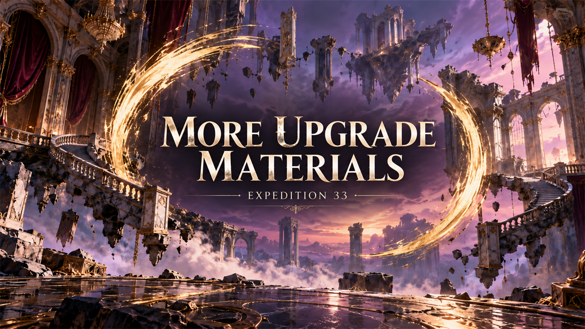

# More Upgrade Materials

Loot gives double Chroma Catalysts, Colours of Lumina and Recoats; Petanks give three times as many.

## What it does

Loot gives more upgrade items: double from enemies, bosses and chests, three times as much from Petanks. This covers
the weapon upgrade materials (Chroma Catalysts), and also Colours of Lumina and Recoats, which come from the same loot.
The drop chances stay the same.

| Source | What drops | Game | Mod |
|---|---|---|---|
| Normal enemies (also weak, strong and elusive ones) | Chroma Catalysts (5-10% chance); Recoat and Perfect Chroma Catalyst (0.5% each) | 1 to 4 | 2 to 8 |
| Elite enemies and bosses | a Chroma Catalyst every time; Recoat (10%); Perfect Chroma Catalyst (5%) | 1 | 2 |
| Alpha enemies | Chroma Catalysts and 5 Colours of Lumina every time; a Perfect Chroma Catalyst | 2 / 5 / 1 | 4 / 10 / 2 |
| Chests | a Chroma Catalyst | 1 | 2 |
| Petanks | Chroma Catalysts, a Recoat and Colours of Lumina every time; Perfect Chroma Catalyst (10%) | 5 / 1 / 5 / 1 | 15 / 3 / 15 / 3 |

- The tier of the Chroma Catalyst follows the level of the area: Chroma Catalyst up to level 9, Polished from 10,
  Resplendent from 30, Grandiose from 60 (normal enemies also drop the lower tiers). Perfect Chroma Catalysts drop only
  in areas of level 100 and more.
- Only these loot tables change; items from other sources (for example merchants) stay as they are.

## Screenshots

## How to install

1. Download the zip of the latest release on GitHub (`expedition33_moreupgradematerials_<version>.zip`).
2. Open the game folder `Sandfall\Content\Paks\`. If it has no folder `~mods`, create it.
3. Unpack the three files of the zip (`expedition33_moreupgradematerials_P.pak`, `.utoc` and `.ucas`) into `Sandfall\Content\Paks\~mods\`.
4. Start the game.

To update the mod, replace the three files with the ones of the new release. To remove it, delete the three files.

## How to use

Nothing to do: the mod works as soon as you load a game. Every loot roll from then on gives the larger amounts.

## Compatibility

- Game version: 1.5.6 (`1.5.6.0`).
- The mod replaces five game files: the upgrade item loot tables `DT_LootTable_UpgradeItems_Regular`, `_Elite`,
  `_Alpha`, `_Exploration` and `_Petank`. A mod that replaces one of them conflicts with this one; only one of them
  works.
- A game update that changes these tables needs a new build of the mod.

## Known issues

None yet.

## How to build

Anyone can build this mod from its source code and check that the download matches it.

1. Install the tools: Windows PowerShell 5.1 (part of Windows), [UAssetGUI](https://github.com/atenfyr/UAssetGUI/releases)
   v1.1.0 and [retoc](https://github.com/trumank/retoc/releases) v0.1.5 in a folder `_tools\uassetgui\` and
   `_tools\retoc\` above the repository (or set `UE5_TOOLS`), and the game's mapping file `Expedition33Mappings-1.5.6.usmap` in
   `%LOCALAPPDATA%\UAssetGUI\Mappings\`. The game must be installed: the build reads the tables' structs
   `S_LootTableSection` and `S_LootTableEntry` from it. `README.md` has the details.
2. Build it: `powershell -ExecutionPolicy Bypass -File .\build.ps1`
3. Find the files: `dist\expedition33_moreupgradematerials_P.pak`, `.utoc` and `.ucas`.

## Credits

Made by Kintaro. MIT license: you may use, change and share this mod. Clair Obscur: Expedition 33 and its files belong to
their makers; the mod changes only what is listed above.
